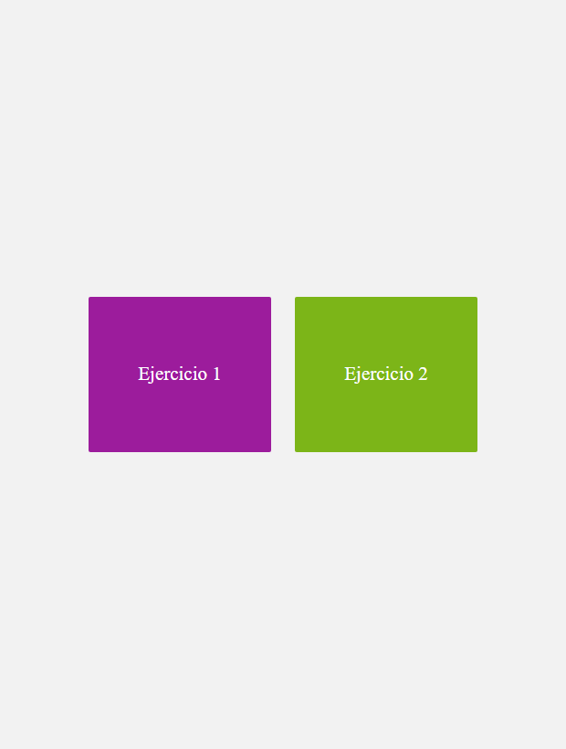
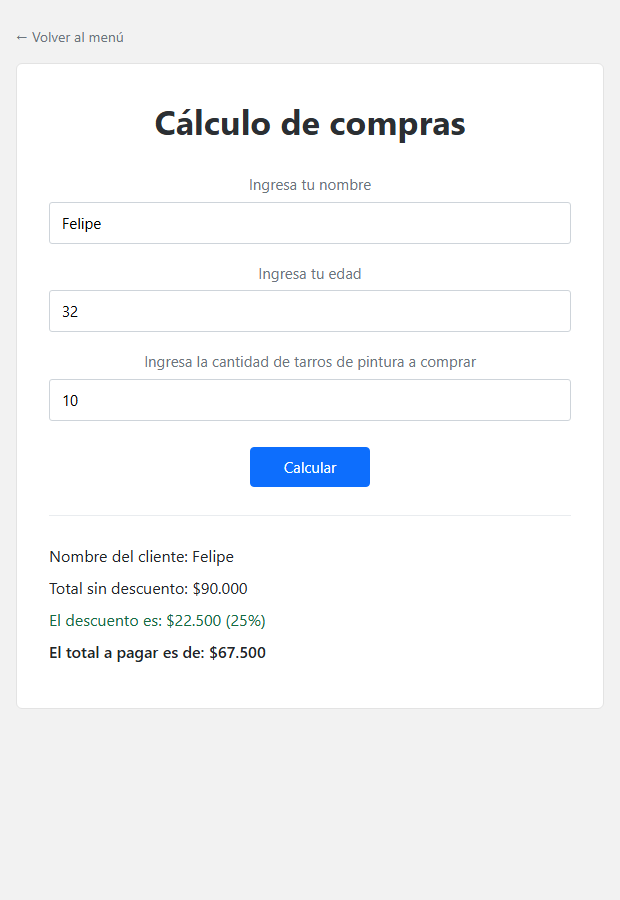
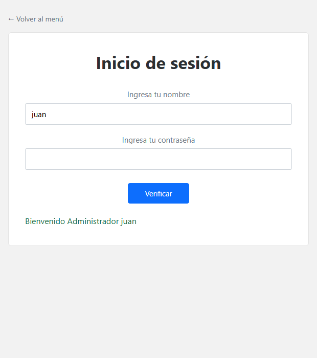

# TA_EX-7

Aplicación hecha con Python y Flask para el encargo TA_EX-7. Tiene un menú con dos
botones: uno abre el cálculo de una compra de tarros de pintura y el otro un inicio
de sesión.

## Cómo ejecutarla

1. Instalar Flask con `pip install -r requirements.txt`.
2. Ejecutar `python main.py`.
3. Abrir http://127.0.0.1:5000 en el navegador.

Está probada con Python 3.12 y Flask 3.1.3.

## Archivos

- `main.py`: rutas, cálculos y validación de los formularios.
- `templates/`: `base.html`, `index.html`, `ejercicio1.html`, `ejercicio2.html` y `error.html`.
- `static/css/estilos.css`: estilos de las páginas.
- `capturas/`: imágenes de la aplicación funcionando.

## Ejercicio 1

Cada tarro de pintura vale $9.000. Si la persona tiene entre 18 y 30 años se aplica
un descuento de 15%, si tiene más de 30 el descuento es de 25%, y si es menor de 18
paga el total sin descuento. La página muestra el nombre del cliente, el total sin
descuento, el monto descontado y el total a pagar.

## Ejercicio 2

Hay dos usuarios registrados: `juan` con contraseña `admin` y `pepe` con contraseña
`user`. Cuando los datos son correctos se muestra "Bienvenido Administrador juan" o
"Bienvenido Usuario pepe". Si no coinciden aparece "Usuario o contraseña incorrectos".

## Antes de entregar

Comprimir la carpeta sin el entorno virtual y subir el ZIP a Blackboard. El enlace
del repositorio de GitHub va en `enlace_repositorio.txt`.

